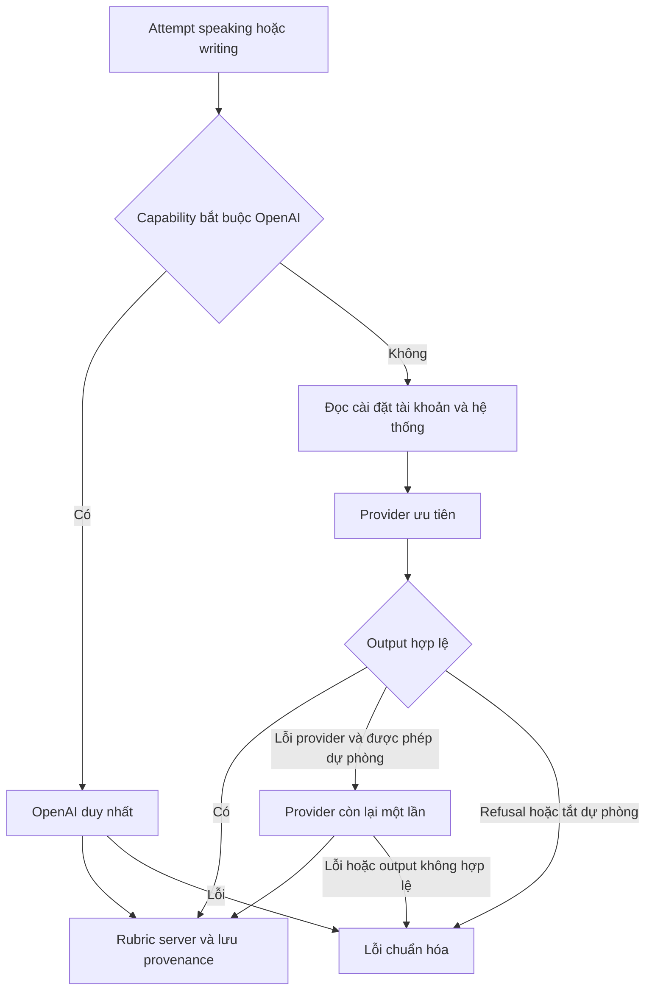

# Chiến lược AI cho WorkLingo

Ngày rà soát: 14 tháng 10 năm 2026. Phạm vi: AI đang có, cài đặt tài khoản và hệ thống. Chatbot được người dùng xác nhận làm sau.

WorkLingo đã bổ sung Discovery qua Chat Completions và ưu tiên `qwen3.8-27b` trong cấu hình local. OpenAI vẫn giữ cấu hình độc lập để dự phòng. Các luồng speech của Microsoft và nghiệp vụ chạy theo quy tắc không cần đổi sang LLM.

## Phân loại nhu cầu của hệ thống

| Tác vụ | Hiện trạng và bằng chứng | Lựa chọn |
| --- | --- | --- |
| Chấm bài viết Foundation, đánh giá ngôn ngữ trong transcript speaking | `teacher-ai/application/evaluation.service.ts` gọi LanguageEvaluationPort; rubric server tổng hợp điểm | Discovery Qwen mặc định; OpenAI dự phòng theo cài đặt |
| Nhận diện giọng nói và metrics phát âm | `ai-gateway/infrastructure/microsoft-speech.adapter.ts`, `teacher-ai/application/transcribe-speech.handler.ts` | Giữ Microsoft; API Discovery đã kiểm tra chưa cung cấp audio cho hai adapter này |
| Tạo audio tiếng Anh | `ai-gateway/infrastructure/microsoft-tts.adapter.ts`, registry TTS, audio settings | Giữ Microsoft và audio đã xuất bản; browser speech là lựa chọn phát phía client |
| Kiểm tra đáp án reading/listening, tiến độ, lịch học, mastery, placement | `learning-sessions`, `mastery`, `engagement`, `onboarding` | Giữ quy tắc deterministic; không phát sinh token |
| Import và publish giáo trình, quản lý admin | `content-authoring` và `admin-curriculum` | Giữ validation/versioning/approval; chưa cần model cho các thao tác CRUD |
| IELTS Bridge và Integrated Practice | Service learner tương ứng gọi evaluator theo bài/task | Giữ evaluator hiện có; không thêm LLM chỉ vì tên endpoint là evaluate |
| IELTS Mock writing/speaking và review band | `ielts-mock-review.service.ts` lưu review của người; learner report chờ teacher review | Giữ người review. Không thay bằng điểm Qwen khi chưa hiệu chuẩn |
| Trợ lý admin, FAQ người học, giải thích lỗi, gợi ý luyện tập | Yêu cầu sản phẩm tương lai; chatbot được hoãn trong phản hồi của người dùng | Đề xuất Discovery cho câu hỏi ngắn có grounding; chưa xây endpoint/chat UI |
| Tổng hợp nội dung phức tạp, tác vụ có capability chỉ adapter OpenAI cung cấp | Chưa có một tác vụ hiện tại được chứng minh bắt buộc dùng OpenAI | Server có thể đặt `routing.requiredProvider = 'openai'`; không downgrade nếu lỗi/thiếu cấu hình |

Nội dung quản trị/giáo trình vẫn cần validation, quyền hạn và versioning dù sau này có model hỗ trợ soạn nháp. Không giao quyền publish cho model. Các quyết định IELTS/qualification tiếp tục theo workflow đã có.

## Model được chọn và căn cứ

Nguồn chính thức: [Model và giá Discovery](https://discovery.intern-ai.org.cn/token-plan/home?tabIndex=3&dockey=04-model-limits-and-pricing.md), [Chat Completions](https://discovery.intern-ai.org.cn/token-plan/home?tabIndex=3&dockey=03-chat-completions.md). Nội dung đã đọc trong trình duyệt do trang là SPA; bảng giá là snapshot, có thể thay đổi.

Giá dưới đây tính bằng **ink points trên một triệu token**, không phải USD/VND. Thứ tự ba giá: input cache hit / input không cache / output.

| Model ID trong ảnh | Giá công bố | Vai trò đề nghị |
| --- | --- | --- |
| `qwen3.8-27b` | 0.1 / 0.8 / 2.7 | Mặc định hiện tại: phản hồi ngắn và JSON rubric; đã kiểm tra API thật |
| `deepseek-v4-flash-0731` | 0.02 / 1 / 4 | Cân nhắc khi cần suy luận phức tạp hơn, phải đo lại chất lượng/độ trễ |
| `deepseek-v4-flash-vision` | 0.02 / 1 / 4 | Chỉ cân nhắc khi có nhu cầu đọc ảnh; chưa có tác vụ vision trong phạm vi này |
| `intern-s2` | Miễn phí có thời hạn | Không chọn mặc định: bài giả timeout ở 30 và 90 giây |
| `Agents-A1` | Miễn phí có thời hạn | Không chọn mặc định: bài giả timeout 30 giây; chưa đủ bằng chứng vận hành |
| `Atria-Dawn-Preview` | Miễn phí có thời hạn | Chưa thử; hướng scientific reasoning, không cần cho phản hồi Foundation hiện tại |
| `Atria-Dawn` | Không có dòng giá trong trang giá đã đọc | Không kết luận miễn phí; chưa cần cho phạm vi hiện tại |
| `deepseek-v4-pro-0813` | 0.15 / 4.5 / 13.5 | Chỉ đánh giá khi có yêu cầu và benchmark chứng minh Flash/Qwen không đạt |
| `glm-5.3` | 2 / 8 / 28 | Chưa có giá trị bổ sung được đo cho các phản hồi ngắn hiện tại |
| `kimi-k2.6` | 1.1 / 6.5 / 27 | Chưa có nhu cầu multimodal/agent riêng trong hệ thống hiện tại |
| `minimax-m3` | 0.42 / 2.1 / 8.4 | Lựa chọn thay thế sau benchmark; chưa ưu tiên so với Qwen |

Một bài viết **giả**, không có dữ liệu người học thật, qua Qwen trả đủ bốn score dimensions và feedback đúng schema trong **5058 ms**. Kết quả này chứng minh kết nối và format; không chứng minh chất lượng sư phạm, độ ổn định theo tải hoặc xác suất đúng ở các mức CEFR. Timeout ở hai model miễn phí là quan sát trên máy và thời điểm thử này, không phải kết luận chung về dịch vụ.

Ví dụ tính phí Qwen theo bảng công bố: 1000 input không cache + 500 output = **0.00215 ink points**, chưa tính retry/fallback. Không có tỷ giá được xác minh từ ink points sang tiền, nên không dự báo tiết kiệm VND hoặc phần trăm chi phí.

## Cài đặt và luồng lựa chọn

- Người học: `/settings/ai`, liên kết từ Settings. Lưu lựa chọn riêng cho tài khoản; mặc định kế thừa hệ thống.
- Admin: `/admin/settings/ai`, gồm chính sách hệ thống và tùy chọn cá nhân. CONTENT_ADMIN đọc chính sách; SYSTEM_ADMIN cập nhật chính sách chung và có audit log.
- Chọn Discovery/OpenAI độc lập. Provider thiếu cấu hình bị khóa; “đã cấu hình” không có nghĩa health check hoặc calibration đã đạt.
- Khi routing bật, thứ tự là capability bắt buộc → lựa chọn tài khoản → mặc định hệ thống. Chỉ gọi provider còn lại một lần khi provider đầu lỗi và dự phòng được phép.
- Refusal/content filter và lỗi ứng dụng không chuyển dự phòng. Tác vụ OpenAI-only không thử Discovery. Không gọi hai bên song song.
- Chính sách hệ thống tắt dự phòng thì tài khoản không bật vượt được. `AI_FALLBACK_ENABLED=false` trong env là giới hạn cứng của server.
- Mỗi kết quả lưu provider/model thực sự trả output; đổi cài đặt không thay kết quả đã hoàn thành hoặc rubric/lesson snapshot.



## Cấu hình server và chi phí

`.env` local được Git bỏ qua. Key Discovery đã lưu ở đó, không nằm trong source, catalog, endpoint hoặc log. OpenAI key hiện có giữ nguyên. Các giá trị mẫu được đưa vào `.env.example` không chứa key.

```dotenv
WORKLINGO_LANGUAGE_EVALUATION_PROVIDER=discovery
DISCOVERY_BASE_URL=https://discovery-api.intern-ai.org.cn/v1
DISCOVERY_MODEL=qwen3.8-27b
AI_DEFAULT_PROVIDER=discovery
AI_ROUTING_ENABLED=true
AI_FALLBACK_ENABLED=true
AI_MAX_OUTPUT_TOKENS=2048
```

Timeout mặc định giữ **30 giây mỗi provider**. Một lượt job có tối đa hai call khi fallback bật. `PROVIDER_MAX_ATTEMPTS` hiện có vẫn giới hạn retry job, mặc định 3, vì vậy trường hợp lỗi có thể lên đến **6 call cho một job**; retries không miễn phí. Không tự đổi retry STT/TTS để tối ưu LLM. Nếu cần chặn retry rộng hơn, cấu hình này tác động tất cả provider jobs.

Với evaluation hoặc STT thật, lease hiệu lực là giá trị lớn hơn giữa `JOB_WORKER_LEASE_MS` và `3 × PROVIDER_TIMEOUT_MS + 10.000 ms`: một lần chuyển giọng nói thành văn bản, hai nhà cung cấp evaluation và thời gian lưu kết quả. Timeout mặc định cho lease tối thiểu 100 giây; cấu hình lease dài hơn vẫn được giữ. Đây là ngân sách có giới hạn, không phải heartbeat gia hạn khi database hoặc event loop bị treo. Các provider hoàn toàn giả lập giữ lease cấu hình cũ.

Chưa có ngân sách tháng bằng số do người dùng chưa đưa mức tiền. Token cap là giới hạn request, **không phải monthly billing cap**. Khi có user thật cần theo dõi usage/billing phía Discovery và OpenAI, quyết định ngân sách rồi bổ sung ledger/budget guard bền vững; không coi phép tính ví dụ là hóa đơn đã đo.

Input gửi ra ngoài chỉ gồm response/transcript và context rubric/lesson cần đánh giá; không gửi account ID, email, cookie hoặc raw recording trong payload LLM. Provider timeout/error được chuẩn hóa và không lưu raw response vào audit report. Microsoft vẫn có luồng audio/consent/retention riêng.

## Migration và rollback

Migration `20261014163000_ai_routing_settings` bổ sung một bảng, FK account cascade và check constraint cho system/account scope. Đã áp dụng local sau khi xác nhận đây là migration duy nhất còn thiếu. Không reset database, seed lại curriculum hoặc sửa snapshot.

Để rollback chắc chắn sang OpenAI, đặt **cả hai**:

```dotenv
WORKLINGO_LANGUAGE_EVALUATION_PROVIDER=openai-compatible
AI_ROUTING_ENABLED=false
```

Sau đó khởi động lại API. Routing tắt thì bỏ qua toàn bộ preference đã lưu, không dự phòng và khóa chỉnh AI settings; giữ bảng để có thể bật lại. Chọn `fake` cũng luôn bỏ qua live adapters, dành cho test/demo. Không xóa bảng hoặc dữ liệu người dùng để rollback.

## Xác minh và điều còn thiếu

Chi tiết kết quả: [Báo cáo tích hợp](DISCOVERY_AI_IMPLEMENTATION_REPORT.md). Dùng fake provider và schema PostgreSQL tách biệt cho tests/E2E. Live check opt-in: `pnpm --filter @worklingo/api exec tsx scripts/check-discovery.mts --live`, một request với dữ liệu giả; không tự chạy ở startup/test.

Giữ gate human calibration từ [AI_CALIBRATION.md](AI_CALIBRATION.md) và Increment 4 trong [IMPLEMENTATION_ROADMAP.md](IMPLEMENTATION_ROADMAP.md). Không có bằng chứng để gỡ gate này hoặc thay người review IELTS. Template System Design Word chưa được xuất vì bundled renderer thiếu LibreOffice; thiết kế thực thi nằm trong `superpowers/specs/2026-10-14-discovery-ai-design.md`.
