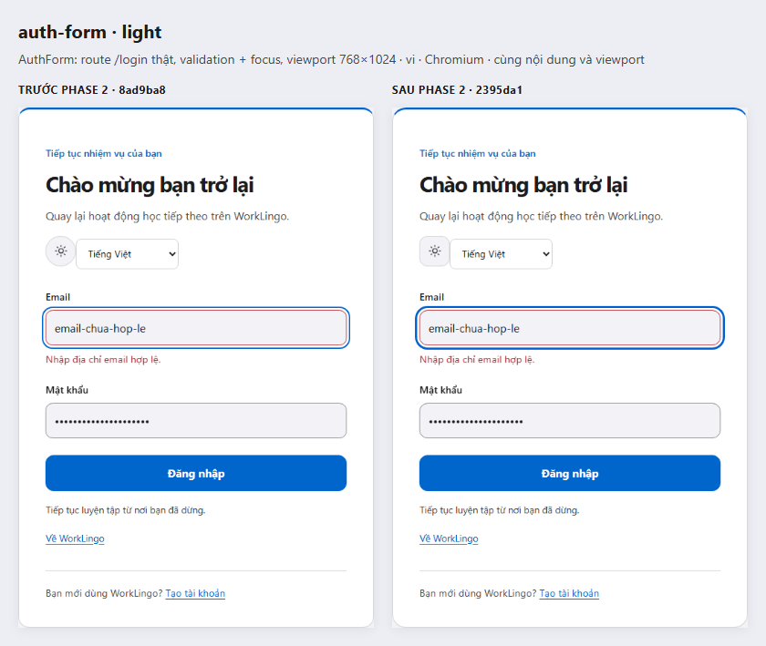
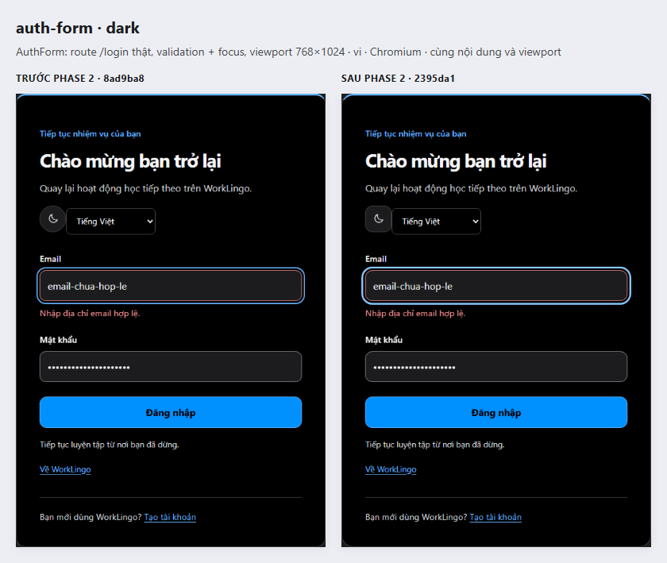
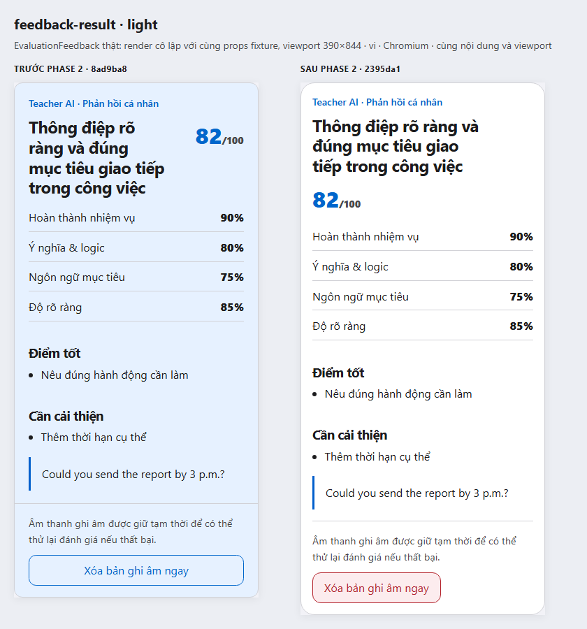
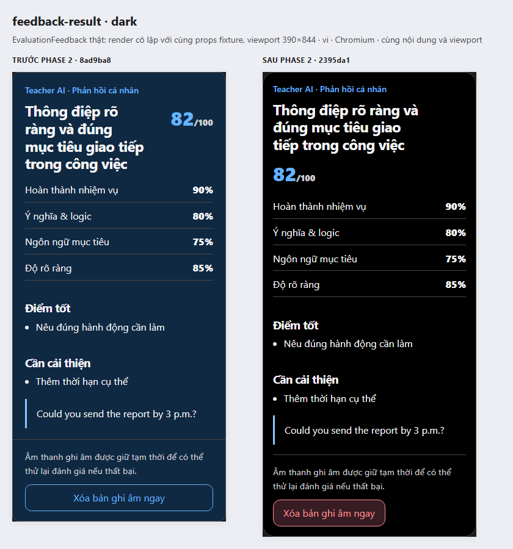
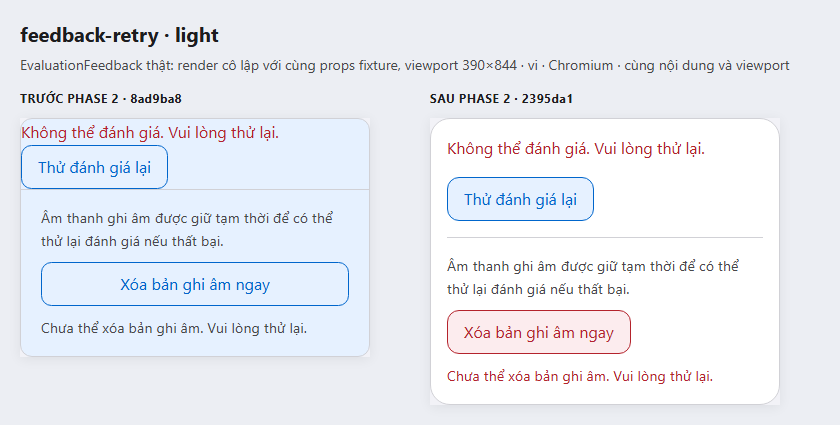
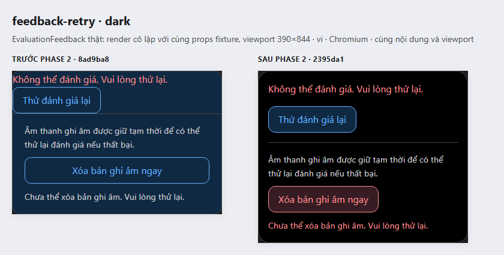

# Component screenshots — before / after Phase 2

Captured2026-10-20 in Chromium, Vietnamese, deviceScaleFactor1, reduced motion. **Left: before Phase2 (`8ad9ba8759c604521d87a6c9f9103b2a917d94bc`). Right: after Phase2 (`2395da17dc634a55ef6fa7a9e3388b6c9f420b75`).** This compares Phase2 only; both sides already include Phase1 tokens/preferences. It is not a comparison against the original dirty main UI.

Images are actual rendered component pixels, arranged side by side in an HTML contact sheet. No generated mockup, recoloring or reconstruction. Each uncombined PNG is retained, with provenance in [manifest.json](manifest.json). These captures demonstrate appearance, not additional route acceptance or complete accessibility certification.

## AuthForm — real `/login` route

The actual route, AuthPage, AuthForm and scoped CSS render both versions. Same768×1024 viewport, invalid email, identical dummy password, frontend validation, email focus; pointer moved away from controls. No authentication request or real credentials. The before snapshot runs local Next webpack dev; after uses the previously verified optimized Next build. The screenshot crops the actual `.auth-panel`, excluding development chrome naturally. Runtime mode difference is disclosed; no performance or screenshot pixel-equality claim is made.

Original pixels: [light before](auth-form-light-before.png), [light after](auth-form-light-after.png), [dark before](auth-form-dark-before.png), [dark after](auth-form-dark-after.png).

## EvaluationFeedback — evaluated result

The actual production `EvaluationFeedback` and `LocaleProvider` are rendered from each version, with identical complete EvaluationDto props, Vietnamese text, score82, retained recording and390×844 viewport. Only the host wrapper is fixture layout (`main`,20px padding); component structure, typography, colors and CSS come from the version's actual sources. This is isolated SSR of the component, not a capture of a real learner session or a backend evaluation.

Original pixels: [light before](feedback-result-light-before.png), [light after](feedback-result-light-after.png), [dark before](feedback-result-dark-before.png), [dark after](feedback-result-dark-after.png).

## EvaluationFeedback — retry and recording deletion error

Same production component with identical retryable-failure and deletion-error props. Shows solid content, padding, tinted retry, destructive deletion styling and error text distinction. Callbacks are inert fixture functions; the screenshot does not claim real retry/deletion transport or new modality.

Original pixels: [light before](feedback-retry-light-before.png), [light after](feedback-retry-light-after.png), [dark before](feedback-retry-dark-before.png), [dark after](feedback-retry-dark-after.png).

## Reproduction and safety

Run `node docs/ui-redesign/evidence/phase2-before-after/capture.cjs` with installed web dependencies and the verified after-version `.next` build. The current product source must still match2395da1; otherwise rebuild/capture the intended version explicitly rather than relabelling a later UI. Before source is extracted with `git archive` from committed, explicitly named frontend/config files into ignored scratch; dependencies are reused through a junction. No checkout, stash, reset, original dirty-source copy, dependency installation, backend operation or new production route. Servers33310/33311 and the capture browser are created and stopped by the script. Initial archive attempt named an absent public directory; the script was corrected to archive actual tracked paths and the successful complete run produced all18 PNGs. Product code was unchanged.

SKILL AUDIT

Used: ui-ux-pro-max → consistent theme/viewport/state and honest component provenance; codex-quota-optimizer → existing Chromium/dependencies and bounded capture; Git workflow/isolation → read-only committed snapshot and explicit own-file staging; verification-before-completion → inspected PNGs, manifest counts and source/original preservation checks.

Verification:6 comparison PNGs plus12 original component PNGs generated successfully; AuthForm frontend-invalid assertions passed for both versions/themes;3 representative comparisons visually inspected. Final source diff against2395da1 empty. No full test suite rerun because this adds evidence only.

Not used: TDD/new feature design/implementation agents/imagegen (no product behavior, redesign or synthetic screenshots); backend/browser installation workflows (not required).
