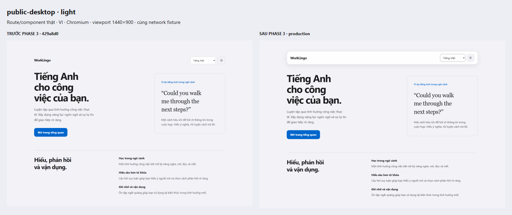
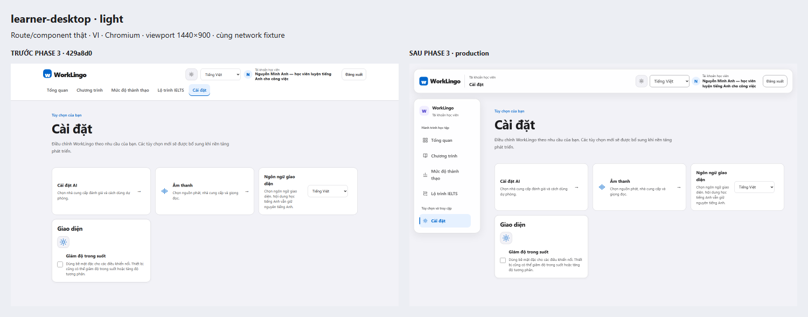
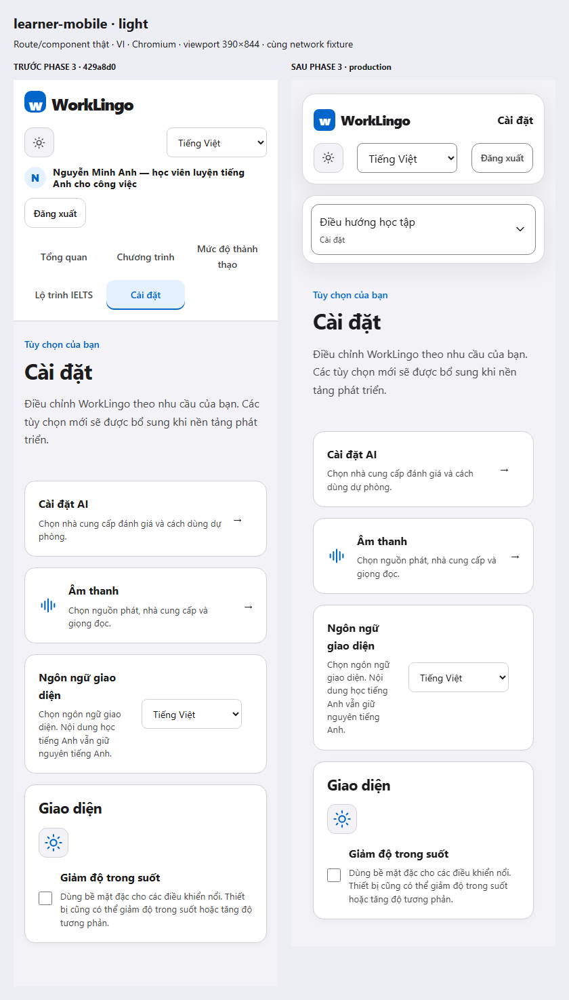
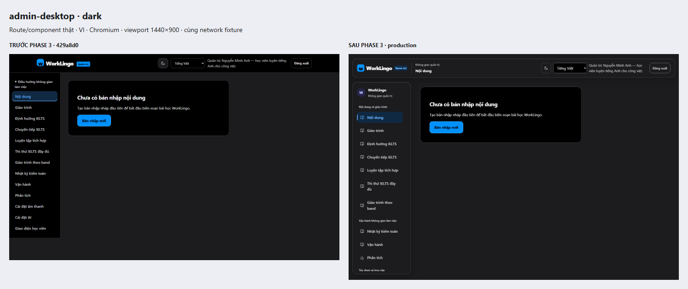
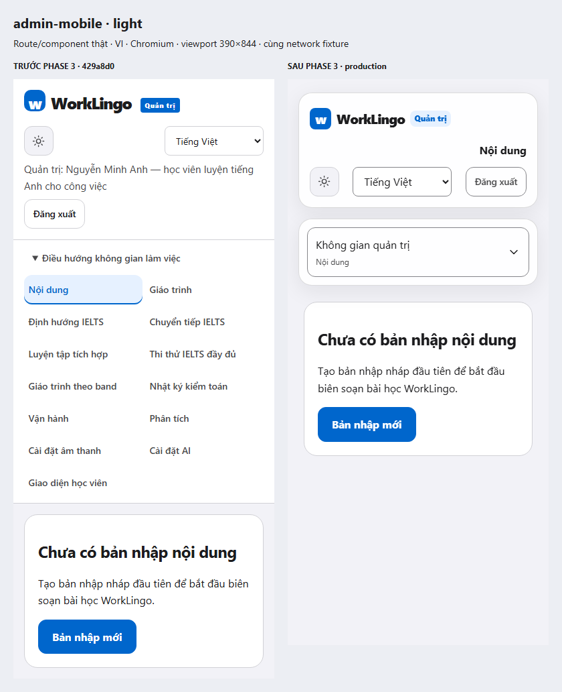
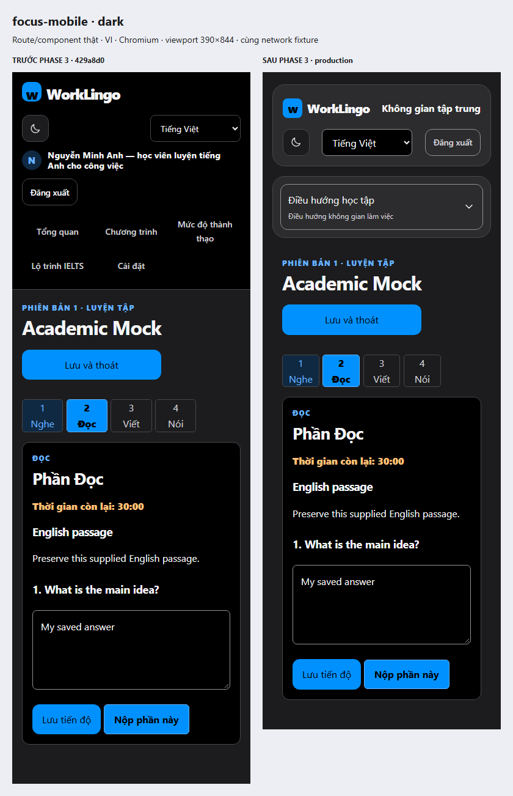

# Actual shell screenshots — before / after Phase 3

Captured2026-10-20, Chromium, VI, deviceScaleFactor1. **Left: Phase2 baseline429a8d0. Right: Phase3 optimized production runtime.** Both sides use the same actual Next routes/components and network fixtures. No real account, backend data, generated mockup, recoloring or reconstructed UI. Before already includes Phase1 tokens and Phase2 shared controls; this is not a comparison against dirty original main.

The12 comparisons below cover six representatives in both themes. Original native PNGs and SHA256 hashes are retained in [visual-manifest.json](visual-manifest.json). Desktop images scale equally to fit the contact sheet; mobile images retain their390px width. Content remains feature-owned and is not counted as migrated. The full after matrix also includes768px/tablet and open disclosure PNGs; open-state captures use the fixed viewport because Chromium full-page capture was observed transiently resizing the document to1×1 and firing real responsive reset behavior.

## Public navigation — `/`

Only header presentation changed; existing hero/content and authenticated CTA retain their source. Guest Login/Register destinations are separately browser-tested.

[Public dark comparison](compare-public-desktop-dark.png).

## Learner desktop — `/settings`

Actual learner shell, five destinations, long Vietnamese identity, solid existing Settings content.

[Learner desktop dark comparison](compare-learner-desktop-dark.png).

## Learner mobile — `/settings`

Default closed in-flow navigation. All five destinations remain available through the disclosure.

[Learner mobile dark](compare-learner-mobile-dark.png), [open navigation light](after-open-learner-light-390.png), [open dark](after-open-learner-dark-390.png).

## Admin desktop — `/admin/content`

Actual ContentList empty state, all13 links, distinct groups, scrollable sidebar; no table/editor blur.

[Admin desktop light comparison](compare-admin-desktop-light.png).

## Admin mobile — `/admin/content`

All destinations use a scrollable nonmodal disclosure rather than a13-tab bottom bar. Content remains in normal flow.

[Admin mobile dark](compare-admin-mobile-dark.png), [open navigation light](after-open-admin-light-390.png), [open dark](after-open-admin-dark-390.png).

## Focus mode — actual IELTS Mock player

Actual `/ielts/mock-tests/[attemptId]`, reading content, answer and deadline from the schema-validated existing fixture. The real timer/autosave execute; transport is intercepted. Timer display can differ by a second between native captures; no timer behavior was changed. Separate interaction evidence verifies stable answer/timer DOM nodes, saved draft and expected PUT revisions through theme/locale/menu/resize actions.

[Focus mobile light](compare-focus-mobile-light.png), [open navigation light](after-open-focus-light-390.png), [open dark](after-open-focus-dark-390.png).

## Reproduction and limits

Current after capture: run `WORKLINGO_FOUNDATION_PRODUCTION=true WORKLINGO_SHELL_EVIDENCE_RUN=matrix pnpm --filter @worklingo/web exec playwright test --config playwright.shell.config.ts` after the intended production build. Environment syntax above is descriptive; use PowerShell `$env:` on Windows. Baseline mode requires the retained429a8d0 optimized build: never label a new build as baseline. The checked-in baseline originals preserve those pixels without switching the user's checkout. `node docs/ui-redesign/evidence/phase3/compare.cjs` only arranges existing PNGs and regenerates their manifest; it does not start the application or modify source.

CSS200% zoom PNGs are separate. Navigation uses native Tab auto-scroll without explicit scrolling. Existing Settings feature content overflow is564px before/596px after at390px; header/nav fit. This limitation is recorded, not certified as whole-page reflow. Native browser zoom, screen-reader, Firefox/WebKit, live auth/backend, recording hardware and full route QA remain unverified. See [Phase3 QA](../../phase3-qa.md).
